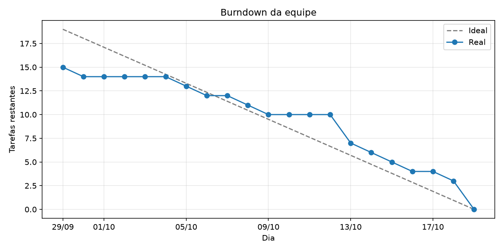

# Relatório Final — Pesquisa de Servidores

**Universidade Federal do Rio Grande — FURG**  
**Disciplina:** Sistemas para Internet II (2026)  

**Integrantes da Equipe:**
- **Júlio César** (`jcesar-fx` — `juliomanolotk@gmail.com`)
- **Mikael** (`mikael` — `mikaelschivi@gmail.com`)
- **Vinícius Martins Borges** (`Vinícius Martins Borges` — `vinimborges@gmail.com`)

---

## 1. Sobre o Projeto

O projeto é uma aplicação web para pesquisar servidores públicos federais (ativos e aposentados) usando dados abertos do [dados.gov.br](https://dados.gov.br) da competência de agosto/2026 (cerca de 1,09 milhão de registros).

Tudo roda em contêineres Docker e sobe automaticamente com um único comando (`docker compose up --build`), dividido em quatro partes:
- **`db`**: Banco de dados PostgreSQL 16 (configurado na pasta `db/`).
- **`loader`**: Script em Python que baixa os arquivos do governo e preenche o banco antes de liberar o sistema.
- **`backend`**: API em Python com Flask e Gunicorn na porta `5000`, responsável pelas buscas, paginação e proteção contra sobrecarga.
- **`frontend`**: Página web feita em Vue 3 + Vite na porta `8080`, onde o usuário faz as pesquisas e navega pelos resultados.

---

## 2. Divisão de Tarefas e Histórico do GitHub

### 2.1. O que cada integrante fez

| Desenvolvedor | Commits | Tarefas realizadas |
| :--- | :---: | :--- |
| **Júlio César (`jcesar-fx`)** | 5 | Criou a estrutura da tabela do banco, fez o script que baixa e carrega os dados do governo (`carregar.py`) e montou a configuração inicial e o Dockerfile do frontend. |
| **Vinícius Martins Borges** | 5 | Desenvolveu a API de busca e validação no backend (`app.py`), criou os testes automatizados (`test_api.py`) e construiu a tela de pesquisa e tabela de resultados (`App.vue` e `main.js`). |
| **Mikael (`mikael`)** | 10 | Configurou o ambiente (`.gitignore`, `.env.example`), criou o Dockerfile do backend com Gunicorn, montou o `docker-compose.yml`, organizou a pasta `db/`, escreveu o `README.md` e gerou o gráfico de burndown (`docs/`). |

### 2.2. Histórico diário de commits

| Data | Desenvolvedor | Commit | O que foi feito no dia |
| :--- | :--- | :--- | :--- |
| `29/09/2026` | Mikael | `5c69326`, `5cb1bee` | Criação do repositório no GitHub e arquivos iniciais. |
| `29/09/2026` | Júlio César | `7ccae4e` | Commit inicial para testar e validar o acesso ao repositório. |
| `29/09/2026` | Vinícius Borges | `d38610c` | Commit inicial para testar e validar o acesso ao repositório. |
| `30/09/2026` | Mikael | `de1ad75` | Criação do `.gitignore` e do `.env.example` com as variáveis do banco. |
| `05/10/2026` | Júlio César | `f2b5779` | Criação da tabela `servidores` em SQL e Dockerfile inicial do banco. |
| `06/10/2026` | Júlio César | `0fd4d26` | Script `backend/carregar.py` para baixar os dados do `dados.gov.br` e inserir no banco. |
| `08/10/2026` | Júlio César | `b7029e6` | Configuração base do projeto Vue 3 com Vite no frontend. |
| `09/10/2026` | Júlio César | `34eb75f` | Criação do `frontend/Dockerfile` para gerar o build e servir na porta 8080. |
| `13/10/2026` | Vinícius Borges | `9d44ba9` | Criação da API `backend/app.py` com filtros, busca exata e similar, paginação e limites de segurança. |
| `13/10/2026` | Mikael | `53ae972` | Criação do `backend/Dockerfile` (com Gunicorn) e `requirements.txt`. |
| `13/10/2026` | Mikael | `56da3a7` | Criação do `docker-compose.yml` conectando banco, loader, backend e frontend. |
| `14/10/2026` | Vinícius Borges | `624c413` | Criação dos testes automatizados do backend com `pytest` (`test_api.py`). |
| `15/10/2026` | Vinícius Borges | `447e443` | Criação da interface `App.vue` com formulário de busca, tabela e paginação. |
| `16/10/2026` | Vinícius Borges | `a12fa21` | Adição do arquivo `main.js` para inicializar o frontend. |
| `18/10/2026` | Mikael | `b6e450f` | Ajuste no `carregar.py` para garantir a criação da tabela antes da carga. |
| `19/10/2026` | Mikael | `f7de350`, `ba1859f` | Escrita do `README.md` completo e limpeza de arquivos de teste antigos. |
| `19/10/2026` | Mikael | `5f1382e` | Organização final da pasta `db/` (`Dockerfile` e `schema.sql`) conforme pedido no trabalho. |
| `19/10/2026` | Mikael | `2f72cf2` | Adição do notebook (`burndown.ipynb`) e imagem do gráfico (`burndown.png`). |

---

## 3. Gráfico de Burndown e Avaliação do Líder Técnico

### 3.1. Gráfico de Burndown

O gráfico abaixo ([burndown.png](burndown.png)), gerado pelo notebook [burndown.ipynb](burndown.ipynb), mostra o ritmo de entregas da equipe entre `29/09` e `19/10`, onde cada commit representa uma tarefa entregue:

### 3.2. Análise da Equipe (Visão do Líder Técnico)

#### Pontos fortes
- **Boa comunicação e convivência:** O grupo teve um ótimo relacionamento durante todo o trabalho. Não houve brigas ou desentendimentos na hora de decidir quem faria cada parte.
- **Comprometimento e confiança:** Depois que dividimos as tarefas, cada integrante assumiu sua responsabilidade com autonomia. Ninguém precisou ficar cobrando o outro o tempo todo, pois todos entregaram o que haviam combinado.
- **Ajuda mútua:** Sempre que alguém encontrava um problema ou ficava em dúvida sobre como fazer algo funcionar, os outros colegas se dispunham a olhar juntos e ajudar a resolver.
- **Cuidado com a organização:** Todos respeitaram o combinado de manter o projeto limpo e escrever mensagens claras nos commits para facilitar o acompanhamento do grupo.

#### Pontos fracos
- **Demora para pegar ritmo no começo:** Como fica claro no gráfico de burndown, começamos devagar na primeira semana e deixamos a maior parte do trabalho pesado acumular para a última semana do prazo.
- **Encontros presenciais/síncronos raros:** Como cada integrante tem uma rotina diferente no dia a dia, quase não conseguimos trabalhar todos juntos no mesmo horário. A comunicação funcionou bem por mensagens, mas reuniões mais frequentes teriam agilizado o início do projeto.
- **Integração deixada para o final:** Cada um focou em terminar a sua parte separadamente e só fomos juntar e testar tudo rodando ao mesmo tempo nos últimos dias, o que gerou correria perto da entrega.

#### Principais dificuldades e impedimentos
- **Conciliar horários e outras disciplinas da faculdade:** A maior dificuldade pessoal da equipe foi encontrar tempo livre em comum. O período do projeto coincidiu com provas, trabalhos de outras matérias e compromissos pessoais, o que explica os dias sem entregas no começo de outubro.
- **Insegurança inicial na divisão do trabalho:** Nos primeiros dias, tivemos certa dificuldade para planejar a ordem das tarefas de um jeito que um integrante não ficasse parado esperando o outro terminar a sua parte.
- **Frustração com a lentidão do site do governo:** Em vários momentos em que tirávamos tempo para testar o projeto, o site do `dados.gov.br` estava lento ou instável para baixar os arquivos, o que atrapalhava o rendimento do estudo naquele dia.
- **Pressão na reta final:** Por termos concentrado muitas entregas a partir do dia 13/10, a última semana exigiu um esforço extra de todos à noite e no fim de semana para revisar detalhes, corrigir a estrutura de pastas e fechar a documentação.

---

## 4. Funcionamento do Docker (`docker compose up --build`)

O projeto foi configurado para subir sozinho a partir da pasta raiz com o comando `docker compose up --build`. A ordem de subida acontece automaticamente:

1. **`db`**: Sobe o banco PostgreSQL (a partir da pasta `db/`) e verifica a cada 5 segundos se ele já está pronto para receber conexões.
2. **`loader`**: Assim que o banco fica pronto, esse serviço roda uma única vez, baixa os arquivos de servidores ativos e aposentados do governo e carrega tudo no banco.
3. **`backend`**: Só inicia depois que o `loader` termina de carregar os dados com sucesso, abrindo a API na porta `5000`.
4. **`frontend`**: Sobe a interface web na porta `8080` conectada ao backend.

---

## 5. Backend, Segurança contra Sobrecarga e Limitações

### 5.1. Como o Backend funciona
A API (`backend/app.py`) roda em Python com Flask usando o servidor **Gunicorn** na porta `5000`. Na rota `GET /api/servidores`, é possível filtrar por `nome`, `cargo`, `orgao` e `uf`:
- **Busca exata (padrão):** Compara o texto inteiro (sem diferenciar maiúsculas de minúsculas) e devolve os resultados divididos em páginas (`page` e `page_size`).
- **Busca similar (`similar=true`):** Permite buscar partes do nome, cargo ou órgão usando `%` como coringa, devolvendo até 100 resultados de uma vez.

### 5.2. Mecanismos de segurança contra sobrecarga paralela
Para evitar que o sistema trave ou caia durante testes pesados com várias buscas ao mesmo tempo, criamos cinco proteções:
1. **Gunicorn com 8 threads e timeout de 15s:** Permite responder várias buscas ao mesmo tempo e reinicia o processo caso alguma requisição trave.
2. **Limite de requisições por IP (Rate Limit):** Cada IP só pode fazer **20 buscas por minuto**. Se passar disso, a API bloqueia na hora com erro `429` antes de pesar no banco.
3. **Tempo máximo de consulta de 5 segundos:** Se uma busca no banco demorar mais de 5 segundos, o próprio PostgreSQL cancela a consulta e a API devolve erro `504` (`"consulta excedeu o tempo limite"`), impedindo que o banco congele.
4. **Limite máximo de 100 resultados por vez:** Nenhuma busca pode pedir mais de 100 registros por página, evitando que o servidor tente carregar mais de 1 milhão de linhas na memória de uma vez.
5. **Bloqueio de buscas abertas e proteção contra SQL Injection:** A busca similar não roda se o usuário não informar pelo menos nome, cargo ou órgão. Além disso, todos os parâmetros são validados e protegidos contra injeção de SQL.

### 5.3. Limitações encontradas
- **Buscas parciais pesadas sob muita concorrência:** Como a tabela tem mais de 1 milhão de servidores e não possui índices extras para texto, buscas parciais com `%` no começo precisam ler a tabela inteira. Se muitas buscas desse tipo forem feitas ao mesmo tempo, elas ficam lentas e são cortadas pelo limite de segurança de 5 segundos (`504`).
- **Contador de limite em memória:** O controle de 20 requisições por minuto fica salvo na memória do processo Python. Por isso, o Gunicorn precisa rodar com apenas 1 processo (*worker*) e 8 *threads* (se tivesse mais processos, cada um contaria o limite separado).
- **Uso de memória na hora de carregar os dados:** O `loader` baixa cerca de 202 MB e monta os dados na memória antes de enviar ao banco, consumindo cerca de 400 a 500 MB de RAM durante os segundos iniciais da carga.
- **Aposentados sem UF:** Na planilha original do governo, os servidores aposentados não têm a coluna de estado (UF). Por isso, ao filtrar por uma UF específica, aparecem apenas servidores ativos.

---

## 6. Funcionamento do Frontend

A página web (`frontend/src/App.vue`) foi feita em Vue 3 com um visual limpo e direto:
- Possui campos para digitar **Nome**, **Cargo**, **Órgão**, escolher a **UF** e marcar a opção de **Busca similar**.
- Exibe o total de servidores encontrados, a tabela organizada com os dados (`Nome`, `Cargo`, `Órgão`, `UF` e `Situação`) e os botões **Anterior** e **Próxima** para mudar de página.
- Enquanto uma busca está carregando, os botões ficam bloqueados para evitar cliques repetidos, e qualquer erro retornado pela API aparece em destaque na tela.
